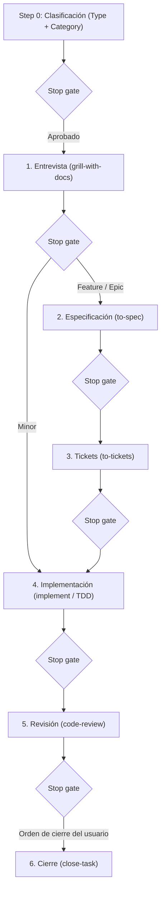

# StrataHarness

[English](README.md) | [Русский](README.ru.md) | [简体中文](README.zh-CN.md) | [Español](README.es.md) | [Français](README.fr.md) | [Português (Portugal)](README.pt-PT.md)

> **Nota:** Este documento es una traducción de [README.md](README.md). En caso de discrepancia o ambigüedad, prevalece la versión original en inglés.

Un repositorio plantilla (Template Repository) listo para producción, diseñado para el desarrollo de software con agentes de programación autónomos basados en IA. Proporciona un ciclo de vida de desarrollo estructurado en 6 etapas, puertas de parada explícitas (stop gates), protocolos de gestión de contexto y una completa biblioteca de habilidades (skills) especializadas para agentes.

Entornos de agentes de IA compatibles:
- **Google Antigravity** (soporte nativo para reglas y skills)
- **Claude Code** (espejado automático de skills en `.claude/skills/`, reglas mediante `CLAUDE.md`)
- **OpenAI Codex / Codex CLI** (reglas mediante `AGENTS.md` compacto)
- **Cursor** (reglas mediante `AGENTS.md`)

---

## Requisitos

### Para proyectos que utilizan esta plantilla
- **git** (versión ≥ 2.30)
- **PowerShell 7+** (`pwsh`): utilizado para scripts de automatización, inicialización, actualizaciones y comprobaciones de integridad en Windows, macOS y Linux.

### Únicamente para el desarrollo de la plantilla
- **Pester 5+**: marco de pruebas para PowerShell (`Install-Module Pester -MinimumVersion 5.0.0`). Solo necesario para los mantenedores de la plantilla al ejecutar las pruebas en `tests/`. No requerido para proyectos derivados.

---

## Crear un nuevo proyecto

1. **Crear un repositorio a partir de la plantilla:**
   - Haz clic en **"Use this template"** en la interfaz de GitHub, o clona el repositorio usando una etiqueta de versión específica:
     ```powershell
     git clone --branch v1.0.0 https://github.com/cannoneer85-svg/StrataHarness.git my-project
     cd my-project
     ```
2. **Inicializar el proyecto:**
   - **Mediante agente de IA (recomendado):** En tu sesión con el agente, escribe `/init-project` (o di *"Initialize new project"*). El agente ejecutará el script determinista y te guiará en la configuración del gestor de tareas, el stack tecnológico ([`.agents/CONTEXT.md`](.agents/CONTEXT.md)) y los estándares de código (`CODING_STANDARDS.md`).
   - **O directamente en la terminal:**
     ```powershell
     pwsh -NoProfile -File .agents/skills/init-project/scripts/Initialize-Project.ps1 -Mode New -Tracker local
     ```

### Qué sucede en el modo `New`
- Elimina los metadatos de desarrollo de la plantilla y los archivos de versión (`tests/`, `docs/dry-run-checklist.md`, especificaciones y ADR de la plantilla, `LICENSE`, `CHANGELOG.md`, `VERSION`, `.github/`, `README.ru.md`, `README.zh-CN.md`, `README.es.md`, `README.fr.md`, `README.pt-PT.md`, `CONTRIBUTING.md`, `SECURITY.md`, `docs/releasing.md` y la skill `release`).
- Conserva [`THIRD_PARTY_NOTICES.md`](THIRD_PARTY_NOTICES.md).
- Configura esqueletos iniciales limpios para tu proyecto (`README.md`, [`.agents/CONTEXT.md`](.agents/CONTEXT.md), `CODING_STANDARDS.md`, [`docs/handoff/LATEST.md`](docs/handoff/LATEST.md)).
- Registra la versión de la plantilla (`vX.Y.Z (<sha>)`) y su origen en la cabecera del Registro de Skills.
- Configura el gestor de tareas (por ejemplo, el gestor local en `.scratch/<feature>/issues/`).

---

## Modos de `Initialize-Project.ps1`

El motor de automatización del ciclo de vida ([`.agents/skills/init-project/scripts/Initialize-Project.ps1`](.agents/skills/init-project/scripts/Initialize-Project.ps1)) admite 4 modos, accesibles tanto de forma interactiva a través del agente de IA como directamente mediante PowerShell:

| Modo | Propósito | Invocación vía Agente IA | Comando directo en CLI |
|---|---|---|---|
| **New** | Crea un proyecto limpio a partir de la plantilla (elimina archivos meta, instala esqueletos). | `/init-project` o *"Initialize new project"* | `pwsh -NoProfile -File .agents/skills/init-project/scripts/Initialize-Project.ps1 -Mode New -Tracker local` |
| **Adopt** | Adopta skills y reglas en un código existente sin sobrescribir archivos del usuario. Informa de conflictos y actualiza `.gitignore`. | `/init-project adopt` o *"Adopt StrataHarness into existing project"* | `pwsh -NoProfile -File <template-path>/.agents/skills/init-project/scripts/Initialize-Project.ps1 -Mode Adopt -RepoRoot . -Tracker local` |
| **Update** | Actualiza reglas y skills en un proyecto existente desde una versión más reciente de la plantilla. Sin `-Apply`, muestra diff y changelog (dry-run); con `-Apply`, aplica los cambios. | `/init-project update` o *"Update template skills"* | `pwsh -NoProfile -File <template-path>/.agents/skills/init-project/scripts/Initialize-Project.ps1 -Mode Update -RepoRoot . -Apply` |
| **SetTracker** | Cambia el proveedor del gestor de tareas (`local`, `github` o `gitlab`). | `/init-project tracker` o *"Switch tracker to github"* | `pwsh -NoProfile -File .agents/skills/init-project/scripts/Initialize-Project.ps1 -Tracker github` |

Todos los modos son idempotentes y seguros de volver a ejecutar.

### Proveedores de gestores de tareas

StrataHarness proporciona 3 adaptadores de seguimiento de incidencias configurados mediante `-Tracker <provider>`:

| Proveedor | Dónde residen las tareas | Requisitos | Ideal para |
|---|---|---|---|
| **`local`** *(predeterminado)* | Archivos Markdown locales en `.scratch/<feature>/issues/` con mapa de dependencias `TICKETS.md`. | Ninguno. Funciona totalmente sin conexión. | Desarrollo individual, repositorios privados o sesiones de IA autónomas sin servicios externos. |
| **`github`** | GitHub Issues dentro del repositorio. | GitHub CLI (`gh`) instalado y autenticado (`gh auth login`). | Proyectos de código abierto o en equipo alojados en GitHub; enlaza tickets con PRs y milestones. |
| **`gitlab`** | GitLab Issues dentro del proyecto. | GitLab CLI (`glab`) instalado y autenticado (`glab auth login`). | Proyectos alojados en GitLab o instancias GitLab autoalojadas; enlaza tareas con Merge Requests. |

Puedes cambiar de proveedor en cualquier momento con `Initialize-Project.ps1 -Tracker <provider>` (o pidiéndoselo al agente: *"Switch tracker to github"*). Solo se modifican [`docs/agents/issue-tracker.md`](docs/agents/issue-tracker.md) y [`AGENTS.md`](AGENTS.md); el código de la aplicación no se toca.

---

## Ciclo de vida de desarrollo (Resumen del flujo)

El comportamiento del agente se rige por reglas estrictas en [`AGENTS.md`](AGENTS.md) (reflejadas para Claude Code en [`CLAUDE.md`](CLAUDE.md)).



### 1. Step 0 — Clasificación previa a cualquier trabajo
En la respuesta inicial, el agente anuncia el **Type** y la **Category** con una justificación de una línea y espera confirmación del usuario:
- **Type:**
  - `Development`: modifica código, configuración o pruebas.
  - `Analysis`: genera un documento de investigación en `docs/analysis/`, sin tocar código.
- **Category (para Development):**
  - `Minor`: 1–2 archivos, un solo módulo, sin nuevas entidades ni integraciones.
  - `Feature`: un subsistema, nueva pantalla/endpoint/entidad, integración con API conocida.
  - `Epic`: múltiples módulos, cambios en arquitectura central o contratos transversales, muchas incógnitas.
  - `Fog (Туман)`: el camino no está claro; se deriva a `wayfinder` para resolver la ambigüedad.

### 2. Rutas y rondas de entrevista
- **Minor:** 1 ronda (Outline & happy path) → implementación In-Place → revisión → cierre.
- **Feature:** 2 rondas (Happy path + Errors & edge cases) → especificación en `docs/specs/` → tickets en `.scratch/<feature>/issues/` con grafo de dependencias `TICKETS.md` → implementación → revisión → cierre.
- **Epic:** 3 rondas (Happy path + Errors & edge cases + NFR) → especificación → tickets → implementación con Orchestrator (subagentes aislados por ticket) → revisión → cierre.
- **Analysis:** 1 ronda corta (4 puntos) → investigación → borrador en `docs/analysis/` → revisión → cierre.
- *Sin límite de preguntas:* las rondas exploran la frontera abierta de decisiones hasta resolverlas; las preguntas de seguimiento se ramifican dentro del tema sin límites artificiales.

### 3. Puertas de parada (Stop Gates)
- **Una etapa por turno:** el agente nunca salta etapas y se detiene a presentar resultados en cada stop gate, esperando aprobación explícita antes de continuar.
- **Salvaguarda estricta:** el agente nunca realiza commits, limpia `.scratch/` ni cierra tareas sin una orden explícita del usuario (por ejemplo, «закрывай задачу», «фиксируй», «делай handoff»). El comando `/release` es el único autorizado para hacer push, y ÚNICAMENTE tras confirmación explícita en el stop gate de release; el force-push está estrictamente prohibido en cualquier circunstancia. Otras skills (incluida `/close-task`) nunca realizan `git push`.

### 4. Handoff frente a Close-task
- **Handoff ([`/handoff`](.agents/skills/handoff/SKILL.md)):** preserva el contexto de la sesión en `docs/handoff/YYYY-MM-DD-<topic>.md`, actualiza `docs/handoff/LATEST.md` y limpia tickets completados. **Nunca realiza commit.**
- **Close-task ([`/close-task`](.agents/skills/close-task/SKILL.md)):** cierra completamente la tarea tras una revisión exitosa y orden del usuario. Ejecuta comprobaciones previas, genera el handoff, limpia `.scratch/<feature>/` y crea un único commit local. **Nunca realiza push.**

### 5. Presupuesto de contexto (Smart Zone)
- El contexto de trabajo se mantiene dentro de la **Smart zone** (≈120k tokens).
- Antes de escribir código, el agente elige la estrategia de ejecución: **In-Place** (en la sesión actual), **Sequential Subagents** (subagentes frescos por ticket) o **Multi-Session** (traspasos de sesión mediante handoffs).

---

## Versionado y actualización de la plantilla

La plantilla sigue [Versionado Semántico (SemVer)](https://semver.org/):
- La fuente de verdad de la versión es el archivo [`VERSION`](VERSION) (`X.Y.Z`) y las etiquetas git anotadas (`vX.Y.Z`).
- El registro de cambios se mantiene en [`CHANGELOG.md`](CHANGELOG.md).

### Actualizar un proyecto derivado
Para actualizar un proyecto existente con mejoras, correcciones de errores o nuevas skills de esta plantilla:

1. **Mediante agente de IA (interactivo):**
   Simplemente dile al agente *"Update template skills"* (o escribe `/init-project update`). El agente comprobará tu `template-version` registrada, consultará la plantilla upstream, presentará las diferencias del CHANGELOG y advertirá sobre cambios incompatibles antes de aplicar la actualización con tu confirmación.

2. **Directamente en PowerShell:**
   - Descarga o clona la etiqueta de versión objetivo:
     ```powershell
     git clone --branch v1.1.0 https://github.com/cannoneer85-svg/StrataHarness.git ../template-release
     ```
   - Previsualiza los cambios (dry-run):
     ```powershell
     pwsh -NoProfile -File ../template-release/.agents/skills/init-project/scripts/Initialize-Project.ps1 -Mode Update -RepoRoot .
     ```
     El script inspecciona tu `template-version`, muestra la versión destino, imprime el extracto relevante del CHANGELOG e identifica posibles cambios mayores (MAJOR).
   - Aplica la actualización:
     ```powershell
     pwsh -NoProfile -File ../template-release/.agents/skills/init-project/scripts/Initialize-Project.ps1 -Mode Update -RepoRoot . -Apply
     ```

---

## Navegación e índice de documentación

- **Enrutador de Skills:** [`/ask`](.agents/skills/ask/SKILL.md) — buscador interactivo de skills.
- **Registro de Skills:** [`.agents/SKILLS.md`](.agents/SKILLS.md) — catálogo completo de skills registradas y sus metadatos.
- **Glosario de conceptos:** [`.agents/CONTEXT.md`](.agents/CONTEXT.md) — términos y conceptos del dominio unificados.
- **Registros de Decisiones Arquitectónicas (ADR):** [`docs/adr/`](docs/adr/) — registro de decisiones de arquitectura.
- **Automatización de releases:** [`docs/releasing.md`](docs/releasing.md) — flujo de release, reglas de incremento de versión y configuración de GitHub.
- **Guía de contribución:** [`CONTRIBUTING.md`](CONTRIBUTING.md) — directrices de contribución, Conventional Commits y checklist de PR.
- **Política de seguridad:** [`SECURITY.md`](SECURITY.md) — reporte de vulnerabilidades y versiones compatibles.
- **Licencia:** [`LICENSE`](LICENSE) — Licencia MIT.
- **Avisos de terceros:** [`THIRD_PARTY_NOTICES.md`](THIRD_PARTY_NOTICES.md) — créditos y licencias de skills adaptadas.
- **Documentación en ruso:** [`README.ru.md`](README.ru.md) — versión completa en ruso de esta guía.
