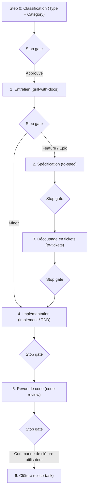

# StrataHarness

[English](README.md) | [Русский](README.ru.md) | [简体中文](README.zh-CN.md) | [Español](README.es.md) | [Français](README.fr.md) | [Português (Portugal)](README.pt-PT.md)

> **Remarque :** Ce document est une traduction de [README.md](README.md). En cas de divergence ou d'ambiguïté, la version originale anglaise prévaut.

Un dépôt modèle (Template Repository) prêt pour la production, conçu pour le développement logiciel assisté par des agents de programmation autonomes pilotés par IA. Il propose un cycle de vie de développement structuré en 6 étapes, des points d'arrêt explicites (stop gates), des protocoles de gestion de contexte rigoureux et une bibliothèque complète de compétences d'agents (skills) spécialisées.

Environnements d'agents IA pris en charge :
- **Google Antigravity** (support natif des règles et skills)
- **Claude Code** (synchronisation automatique des skills dans `.claude/skills/`, règles via `CLAUDE.md`)
- **OpenAI Codex / Codex CLI** (règles via un fichier `AGENTS.md` compact)
- **Cursor** (règles via `AGENTS.md`)

---

## Prérequis

### Pour les projets basés sur ce modèle
- **git** (version ≥ 2.30)
- **PowerShell 7+** (`pwsh`) — utilisé pour les scripts d'automatisation, d'initialisation, de mise à jour et de contrôle d'intégrité sur Windows, macOS et Linux.

### Uniquement pour le développement du modèle
- **Pester 5+** — framework de test pour PowerShell (`Install-Module Pester -MinimumVersion 5.0.0`). Requis uniquement pour les mainteneurs du modèle afin d'exécuter la suite dans `tests/`. Non requis pour les projets en aval.

---

## Créer un nouveau projet

1. **Créer un dépôt à partir du modèle :**
   - Cliquez sur **"Use this template"** sur l'interface GitHub, ou clonez le dépôt à partir d'un tag de version spécifique :
     ```powershell
     git clone --branch v1.0.0 https://github.com/cannoneer85-svg/StrataHarness.git my-project
     cd my-project
     ```
2. **Initialiser le projet :**
   - **Via l'agent IA (recommandé) :** Dans votre session d'agent, tapez `/init-project` (ou dites *"Initialize new project"*). L'agent exécute le script déterministe et vous guide dans la configuration du gestionnaire de tâches, de la stack technique ([`.agents/CONTEXT.md`](.agents/CONTEXT.md)) et des conventions de code (`CODING_STANDARDS.md`).
   - **Ou directement via le terminal :**
     ```powershell
     pwsh -NoProfile -File .agents/skills/init-project/scripts/Initialize-Project.ps1 -Mode New -Tracker local
     ```

### Ce qui se passe en mode `New`
- Suppression des métadonnées de développement et des fichiers de publication du modèle (`tests/`, `docs/dry-run-checklist.md`, spécifications et ADRs internes du modèle, `LICENSE`, `CHANGELOG.md`, `VERSION`, `.github/`, `README.ru.md`, `README.zh-CN.md`, `README.es.md`, `README.fr.md`, `README.pt-PT.md`, `CONTRIBUTING.md`, `SECURITY.md`, `docs/releasing.md` ainsi que la skill `release`).
- Préservation de [`THIRD_PARTY_NOTICES.md`](THIRD_PARTY_NOTICES.md).
- Mise en place de structures squelettes initiales pour votre projet (`README.md`, [`.agents/CONTEXT.md`](.agents/CONTEXT.md), `CODING_STANDARDS.md`, `docs/handoff/LATEST.md`).
- Enregistrement de la version du modèle (`vX.Y.Z (<sha>)`) et de sa source dans l'en-tête du registre de skills.
- Configuration du gestionnaire de tâches (par exemple, le tracker local dans `.scratch/<feature>/issues/`).

---

## Modes de `Initialize-Project.ps1`

Le moteur d'automatisation du cycle de vie ([`.agents/skills/init-project/scripts/Initialize-Project.ps1`](.agents/skills/init-project/scripts/Initialize-Project.ps1)) prend en charge 4 modes, accessibles interactivement via l'agent IA ou directement dans PowerShell :

| Mode | Objectif | Invocation via Agent IA | Commande directe CLI |
|---|---|---|---|
| **New** | Crée un projet propre à partir du modèle (nettoie les méta-fichiers, installe les squelettes). | `/init-project` ou *"Initialize new project"* | `pwsh -NoProfile -File .agents/skills/init-project/scripts/Initialize-Project.ps1 -Mode New -Tracker local` |
| **Adopt** | Intègre les skills et les règles dans un projet existant sans écraser les fichiers utilisateur. Génère un rapport de conflits et met à jour `.gitignore`. | `/init-project adopt` ou *"Adopt StrataHarness into existing project"* | `pwsh -NoProfile -File <template-path>/.agents/skills/init-project/scripts/Initialize-Project.ps1 -Mode Adopt -RepoRoot . -Tracker local` |
| **Update** | Met à jour les règles et skills dans un projet existant depuis une version plus récente du modèle. Sans `-Apply`, affiche le diff et le changelog (simulation dry-run) ; avec `-Apply`, applique les changements. | `/init-project update` ou *"Update template skills"* | `pwsh -NoProfile -File <template-path>/.agents/skills/init-project/scripts/Initialize-Project.ps1 -Mode Update -RepoRoot . -Apply` |
| **SetTracker** | Bascule de fournisseur de gestionnaire de tâches (`local`, `github` ou `gitlab`). | `/init-project tracker` ou *"Switch tracker to github"* | `pwsh -NoProfile -File .agents/skills/init-project/scripts/Initialize-Project.ps1 -Tracker github` |

Tous les modes sont idempotents et peuvent être réexécutés en toute sécurité.

### Fournisseurs de gestionnaires de tâches

StrataHarness fournit 3 adaptateurs configurables via `-Tracker <provider>` :

| Fournisseur | Emplacement des tâches | Prérequis | Idéal pour |
|---|---|---|---|
| **`local`** *(par défaut)* | Fichiers Markdown locaux dans `.scratch/<feature>/issues/` avec carte de dépendances `TICKETS.md`. | Aucun. Fonctionne entièrement hors-ligne. | Développement individuel, dépôts privés ou sessions autonomes sans services externes. |
| **`github`** | GitHub Issues au sein du dépôt. | GitHub CLI (`gh`) installé et authentifié (`gh auth login`). | Projets open source ou d'équipe hébergés sur GitHub ; lie les tickets aux PRs et jalons. |
| **`gitlab`** | GitLab Issues au sein du projet. | GitLab CLI (`glab`) installé et authentifié (`glab auth login`). | Projets hébergés sur GitLab ou GitLab auto-hébergé ; lie les tickets aux Merge Requests. |

Vous pouvez changer de fournisseur à tout moment avec `Initialize-Project.ps1 -Tracker <provider>` (ou en demandant à l'agent : *"Switch tracker to github"*). Seuls [`docs/agents/issue-tracker.md`](docs/agents/issue-tracker.md) et [`AGENTS.md`](AGENTS.md) sont modifiés ; le code applicatif reste intact.

---

## Cycle de vie du développement (Aperçu du workflow)

Le comportement de l'agent est régi par des règles strictes définies dans [`AGENTS.md`](AGENTS.md) (reproduites pour Claude Code dans [`CLAUDE.md`](CLAUDE.md)).



### 1. Step 0 — Classification avant toute action
Dans sa réponse initiale, l'agent annonce le **Type** et la **Category** accompagnés d'une justification synthétique et attend l'approbation de l'utilisateur :
- **Type :**
  - `Development` — modifie le code, la configuration ou les tests.
  - `Analysis` — produit un rapport de recherche dans `docs/analysis/`, sans toucher au code.
- **Category (pour Development) :**
  - `Minor` — 1 à 2 fichiers, un seul module, pas de nouvelles entités ni d'intégrations externes.
  - `Feature` — un sous-système, nouvel écran/point d'accès/entité, intégration avec API connue.
  - `Epic` — plusieurs modules, modifications de l'architecture centrale ou de contrats transverses, nombreuses inconnues.
  - `Fog (Туман)` — le chemin est incertain ; dirigé vers `wayfinder` pour lever les ambiguïtés.

### 2. Parcours et tours d'entretien
- **Minor :** 1 tour (Outline & happy path) → implémentation In-Place → revue → clôture.
- **Feature :** 2 tours (Happy path + Errors & edge cases) → spécification dans `docs/specs/` → tickets dans `.scratch/<feature>/issues/` avec graphe de dépendances `TICKETS.md` → implémentation → revue → clôture.
- **Epic :** 3 tours (Happy path + Errors & edge cases + NFR) → spécification → tickets → implémentation Orchestrator (sous-agents dédiés et isolés par ticket) → revue → clôture.
- **Analysis :** 1 tour court (4 points) → recherche → ébauche dans `docs/analysis/` → revue → clôture.
- *Pas de plafond de questions :* les tours explorent la frontière des décisions ouvertes jusqu'à résolution ; les questions de suivi se ramifient au sein du thème sans limites arbitraires.

### 3. Points d'arrêt (Stop Gates)
- **Une étape par réponse :** l'agent ne saute jamais d'étape et s'arrête systématiquement pour présenter ses résultats à chaque stop gate, en attendant une confirmation explicite avant de continuer.
- **Garde-fou strict :** l'agent ne commite jamais, ne nettoie pas `.scratch/` et ne clôture aucune tâche sans commande explicite (ex. «закрывай задачу», «фиксируй», «делай handoff»). La commande `/release` est la seule habilitée à effectuer un push, et UNIQUEMENT après validation explicite lors du stop gate de release ; le force-push est rigoureusement interdit. Les autres skills (dont `/close-task`) n'effectuent jamais de `git push`.

### 4. Handoff vs Close-task
- **Handoff ([`/handoff`](.agents/skills/handoff/SKILL.md)) :** préserve le contexte de la session dans `docs/handoff/YYYY-MM-DD-<topic>.md`, met à jour `docs/handoff/LATEST.md` et nettoie les tickets terminés. **Ne crée aucun commit.**
- **Close-task ([`/close-task`](.agents/skills/close-task/SKILL.md)) :** finalise complètement une tâche après une revue validée et sur ordre de l'utilisateur. Exécute les vérifications préalables, génère le handoff, supprime `.scratch/<feature>/` et crée un commit local unique. **N'effectue jamais de push.**

### 5. Gestion du contexte (Smart Zone)
- Le contexte opérationnel est maintenu dans la **Smart zone** (≈120k tokens).
- Avant de coder, l'agent sélectionne une stratégie d'exécution : **In-Place** (au sein de la session courante), **Sequential Subagents** (sous-agents dédiés par ticket) ou **Multi-Session** (passages de relais structurés via handoffs).

---

## Gestion des versions et mise à jour du modèle

Le modèle suit le [Versionnage Sémantique (SemVer)](https://semver.org/) :
- La source de vérité de la version est le fichier [`VERSION`](VERSION) (`X.Y.Z`) ainsi que les tags git annotés (`vX.Y.Z`).
- L'historique des changements est consigné dans [`CHANGELOG.md`](CHANGELOG.md).

### Mettre à jour un projet en aval
Pour intégrer à un projet existant les améliorations, correctifs ou nouvelles skills issus de ce modèle :

1. **Via l'agent IA (interactif) :**
   Demandez simplement à votre agent *"Update template skills"* (ou tapez `/init-project update`). L'agent vérifie votre `template-version` enregistrée, consulte le modèle source, présente le diff du CHANGELOG ainsi que les éventuelles ruptures de compatibilité, et demande votre accord avant d'appliquer les changements.

2. **Directement dans PowerShell :**
   - Récupérez ou clonez le tag de version cible du modèle :
     ```powershell
     git clone --branch v1.1.0 https://github.com/cannoneer85-svg/StrataHarness.git ../template-release
     ```
   - Prévisualisez les modifications (simulation dry-run) :
     ```powershell
     pwsh -NoProfile -File ../template-release/.agents/skills/init-project/scripts/Initialize-Project.ps1 -Mode Update -RepoRoot .
     ```
     Le script inspecte votre `template-version`, affiche la version cible, détaille le CHANGELOG intermédiaire et signale tout changement majeur (MAJOR).
   - Appliquez la mise à jour :
     ```powershell
     pwsh -NoProfile -File ../template-release/.agents/skills/init-project/scripts/Initialize-Project.ps1 -Mode Update -RepoRoot . -Apply
     ```

---

## Navigation et index documentaire

- **Routeur de skills :** [`/ask`](.agents/skills/ask/SKILL.md) — recherche interactive de skills.
- **Registre des skills :** [`.agents/SKILLS.md`](.agents/SKILLS.md) — catalogue complet des skills enregistrées et leurs métadonnées.
- **Glossaire terminologique :** [`.agents/CONTEXT.md`](.agents/CONTEXT.md) — définitions unifiées du processus et du domaine.
- **Décisions d'architecture (ADR) :** [`docs/adr/`](docs/adr/) — journal des choix d'architecture.
- **Automatisation des releases :** [`docs/releasing.md`](docs/releasing.md) — workflow de publication, règles de bump et configuration GitHub.
- **Guide de contribution :** [`CONTRIBUTING.md`](CONTRIBUTING.md) — consignes de contribution, Conventional Commits et checklist PR.
- **Politique de sécurité :** [`SECURITY.md`](SECURITY.md) — signalement des vulnérabilités et versions prises en charge.
- **Licence :** [`LICENSE`](LICENSE) — Licence MIT.
- **Mentions de tiers :** [`THIRD_PARTY_NOTICES.md`](THIRD_PARTY_NOTICES.md) — crédits et licences des skills adaptées.
- **Documentation en russe :** [`README.ru.md`](README.ru.md) — version russe complète de ce guide.
