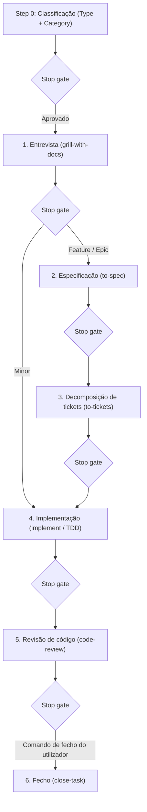

# StrataHarness

[English](README.md) | [Русский](README.ru.md) | [简体中文](README.zh-CN.md) | [Español](README.es.md) | [Français](README.fr.md) | [Português (Portugal)](README.pt-PT.md)

> **Nota:** Este documento é uma tradução de [README.md](README.md). Em caso de divergência ou ambiguidade, prevalece a versão original em inglês.

Um repositório modelo (Template Repository) pronto para produção, concebido para o desenvolvimento de software com agentes autónomos de programação orientados por IA. Disponibiliza um ciclo de vida de desenvolvimento estruturado em 6 etapas, portões de paragem explícitos (stop gates), protocolos rigorosos de gestão de contexto e uma biblioteca abrangente de competências especializadas para agentes (skills).

Ambientes de agentes de IA suportados:
- **Google Antigravity** (suporte nativo para regras e skills)
- **Claude Code** (espelhamento automático de skills em `.claude/skills/`, regras através de `CLAUDE.md`)
- **OpenAI Codex / Codex CLI** (regras através de `AGENTS.md` compacto)
- **Cursor** (regras através de `AGENTS.md`)

---

## Requisitos

### Para projetos que utilizam este modelo
- **git** (versão ≥ 2.30)
- **PowerShell 7+** (`pwsh`) — utilizado para scripts de automação, inicialização, atualizações e validações de integridade em Windows, macOS e Linux.

### Exclusivamente para o desenvolvimento do modelo
- **Pester 5+** — framework de testes em PowerShell (`Install-Module Pester -MinimumVersion 5.0.0`). Necessário apenas para os mantenedores do modelo executarem os testes em `tests/`. Não é requerido para projetos derivados.

---

## Criar um novo projeto

1. **Criar um repositório a partir do modelo:**
   - Clique em **"Use this template"** na interface do GitHub, ou clone o repositório utilizando uma etiqueta de versão específica:
     ```powershell
     git clone --branch v1.0.0 https://github.com/cannoneer85-svg/StrataHarness.git my-project
     cd my-project
     ```
2. **Inicializar o projeto:**
   - **Através do agente de IA (recomendado):** Na sua sessão com o agente, digite `/init-project` (ou diga *"Initialize new project"*). O agente executa o script determinístico e orienta a configuração do gestor de tarefas, da stack tecnológica ([`.agents/CONTEXT.md`](.agents/CONTEXT.md)) e das convenções de código (`CODING_STANDARDS.md`).
   - **Ou diretamente através do terminal:**
     ```powershell
     pwsh -NoProfile -File .agents/skills/init-project/scripts/Initialize-Project.ps1 -Mode New -Tracker local
     ```

### O que acontece no modo `New`
- Elimina os metadados de desenvolvimento do modelo e ficheiros de lançamento (`tests/`, `docs/dry-run-checklist.md`, especificações e ADRs internas do modelo, `LICENSE`, `CHANGELOG.md`, `VERSION`, `.github/`, `README.ru.md`, `README.zh-CN.md`, `README.es.md`, `README.fr.md`, `README.pt-PT.md`, `CONTRIBUTING.md`, `SECURITY.md`, `docs/releasing.md` e a skill `release`).
- Preserva [`THIRD_PARTY_NOTICES.md`](THIRD_PARTY_NOTICES.md).
- Configura esqueletos iniciais limpos para o seu projeto (`README.md`, [`.agents/CONTEXT.md`](.agents/CONTEXT.md), `CODING_STANDARDS.md`, [`docs/handoff/LATEST.md`](docs/handoff/LATEST.md)).
- Regista a versão do modelo (`vX.Y.Z (<sha>)`) e a respetiva origem no cabeçalho do Registo de Skills.
- Configura o gestor de tarefas (por exemplo, o gestor local em `.scratch/<feature>/issues/`).

---

## Modos de `Initialize-Project.ps1`

O motor de automação do ciclo de vida ([`.agents/skills/init-project/scripts/Initialize-Project.ps1`](.agents/skills/init-project/scripts/Initialize-Project.ps1)) suporta 4 modos, acessíveis interativamente através do agente de IA ou diretamente no PowerShell:

| Modo | Finalidade | Invocação via Agente IA | Comando direto CLI |
|---|---|---|---|
| **New** | Cria um projeto limpo a partir do modelo (remove ficheiros meta, instala esqueletos). | `/init-project` ou *"Initialize new project"* | `pwsh -NoProfile -File .agents/skills/init-project/scripts/Initialize-Project.ps1 -Mode New -Tracker local` |
| **Adopt** | Adota skills e regras numa base de código existente sem substituir ficheiros do utilizador. Apresenta relatório de conflitos e atualiza `.gitignore`. | `/init-project adopt` ou *"Adopt StrataHarness into existing project"* | `pwsh -NoProfile -File <template-path>/.agents/skills/init-project/scripts/Initialize-Project.ps1 -Mode Adopt -RepoRoot . -Tracker local` |
| **Update** | Atualiza regras e skills num projeto existente a partir de uma versão mais recente do modelo. Sem `-Apply`, mostra diff e changelog (dry-run); com `-Apply`, aplica as alterações. | `/init-project update` ou *"Update template skills"* | `pwsh -NoProfile -File <template-path>/.agents/skills/init-project/scripts/Initialize-Project.ps1 -Mode Update -RepoRoot . -Apply` |
| **SetTracker** | Altera o fornecedor do gestor de tarefas (`local`, `github` ou `gitlab`). | `/init-project tracker` ou *"Switch tracker to github"* | `pwsh -NoProfile -File .agents/skills/init-project/scripts/Initialize-Project.ps1 -Tracker github` |

Todos os modos são idempotentes e seguros para reexecução.

### Fornecedores de gestores de tarefas

O StrataHarness disponibiliza 3 adaptadores de acompanhamento de tarefas, configurados através de `-Tracker <provider>`:

| Fornecedor | Onde residem as tarefas | Requisitos | Ideal para |
|---|---|---|---|
| **`local`** *(predefinição)* | Ficheiros Markdown locais sob `.scratch/<feature>/issues/` com mapa de dependências `TICKETS.md`. | Nenhum. Funciona perfeitamente offline. | Desenvolvimento individual, repositórios privados ou sessões de IA autónomas sem serviços externos. |
| **`github`** | GitHub Issues no repositório. | GitHub CLI (`gh`) instalado e autenticado (`gh auth login`). | Projetos open-source ou de equipa alojados no GitHub; associa tickets a PRs e marcos. |
| **`gitlab`** | GitLab Issues no projeto. | GitLab CLI (`glab`) instalado e autenticado (`glab auth login`). | Projetos alojados no GitLab ou instâncias próprias de GitLab; associa tarefas a Merge Requests. |

Pode mudar de fornecedor a qualquer altura com `Initialize-Project.ps1 -Tracker <provider>` (ou pedindo ao agente: *"Switch tracker to github"*). Apenas [`docs/agents/issue-tracker.md`](docs/agents/issue-tracker.md) e [`AGENTS.md`](AGENTS.md) são modificados; o código da aplicação não é tocado.

---

## Ciclo de vida de desenvolvimento (Resumo do fluxo)

O comportamento do agente é orientado por regras rigorosas em [`AGENTS.md`](AGENTS.md) (espelhadas para Claude Code em [`CLAUDE.md`](CLAUDE.md)).



### 1. Step 0 — Classificação prévia a qualquer trabalho
Na resposta inicial, o agente anuncia o **Type** e a **Category** acompanhados de uma justificação de uma linha e aguarda a confirmação do utilizador:
- **Type:**
  - `Development` — altera código, configuração ou testes.
  - `Analysis` — produz um documento de investigação em `docs/analysis/`, mantendo o código intacto.
- **Category (para Development):**
  - `Minor` — 1 a 2 ficheiros, um único módulo, sem novas entidades ou integrações externas.
  - `Feature` — um subsistema, novo ecrã/endpoint/entidade, integração com API conhecida.
  - `Epic` — múltiplos módulos, alterações na arquitetura principal ou contratos transversais, muitas incógnitas.
  - `Fog (Туман)` — o caminho não está claro; encaminhado para `wayfinder` para resolver ambiguidades.

### 2. Rotas e rondas de entrevista
- **Minor:** 1 ronda (Outline & happy path) → implementação In-Place → revisão → fecho.
- **Feature:** 2 rondas (Happy path + Errors & edge cases) → especificação em `docs/specs/` → tickets em `.scratch/<feature>/issues/` com grafo de dependências `TICKETS.md` → implementação → revisão → fecho.
- **Epic:** 3 rondas (Happy path + Errors & edge cases + NFR) → especificação → tickets → implementação via Orchestrator (subagentes isolados por ticket) → revisão → fecho.
- **Analysis:** 1 ronda curta (4 pontos) → investigação → rascunho em `docs/analysis/` → revisão → fecho.
- *Sem limite de perguntas:* as rondas exploram a fronteira de decisões abertas até à sua resolução; perguntas de seguimento ramificam dentro do tema sem limites numéricos artificiais.

### 3. Portões de paragem (Stop Gates)
- **Uma etapa por turno:** o agente nunca salta etapas e para obrigatoriamente para apresentar resultados em cada stop gate, aguardando aprovação explícita antes de prosseguir.
- **Barreira de segurança estrita:** o agente nunca efetua commit, não limpa `.scratch/` nem fecha tarefas sem um comando explícito do utilizador (ex.: «закрывай задачу», «фиксируй», «делай handoff»). O comando `/release` é o único autorizado a efetuar push, e EXCLUSIVAMENTE após confirmação explícita no stop gate de release; o force-push é expressamente proibido sob quaisquer circunstâncias. As restantes skills (incluindo `/close-task`) nunca realizam `git push`.

### 4. Handoff vs Close-task
- **Handoff ([`/handoff`](.agents/skills/handoff/SKILL.md)):** preserva o contexto da sessão em `docs/handoff/YYYY-MM-DD-<topic>.md`, atualiza `docs/handoff/LATEST.md` e limpa tickets concluídos. **Nunca cria commit.**
- **Close-task ([`/close-task`](.agents/skills/close-task/SKILL.md)):** encerra por completo uma tarefa após revisão bem-sucedida e mediante ordem do utilizador. Executa verificações preliminares, gera o handoff, limpa `.scratch/<feature>/` e cria um commit local único. **Nunca realiza push.**

### 5. Gestão de contexto (Smart Zone)
- O contexto de trabalho é mantido dentro da **Smart zone** (≈120k tokens).
- Antes de iniciar a programação, o agente seleciona a estratégia de execução: **In-Place** (na sessão corrente), **Sequential Subagents** (subagentes dedicados por ticket) ou **Multi-Session** (transições de sessão via handoffs).

---

## Gestão de versões e atualização do modelo

O modelo segue as regras de [Versionamento Semântico (SemVer)](https://semver.org/):
- A fonte da verdade da versão é o ficheiro [`VERSION`](VERSION) (`X.Y.Z`) e as etiquetas git anotadas (`vX.Y.Z`).
- O registo de alterações é mantido em [`CHANGELOG.md`](CHANGELOG.md).

### Atualizar um projeto derivado
Para incorporar num projeto existente as melhorias, correções ou novas skills provenientes deste modelo:

1. **Através do agente de IA (interativo):**
   Basta pedir ao agente *"Update template skills"* (ou escrever `/init-project update`). O agente verifica a `template-version` registada, consulta o modelo a montante, apresenta o diff do CHANGELOG e eventuais quebras de compatibilidade, solicitando confirmação antes de aplicar.

2. **Diretamente no PowerShell:**
   - Obtenha ou clone a etiqueta de versão pretendida:
     ```powershell
     git clone --branch v1.1.0 https://github.com/cannoneer85-svg/StrataHarness.git ../template-release
     ```
   - Pré-visualize as alterações (simulação dry-run):
     ```powershell
     pwsh -NoProfile -File ../template-release/.agents/skills/init-project/scripts/Initialize-Project.ps1 -Mode Update -RepoRoot .
     ```
     O script inspeciona a sua `template-version`, indica a versão de destino, exibe o excerto relevante do CHANGELOG e sinaliza eventuais alterações estruturais importantes (MAJOR).
   - Aplique a atualização:
     ```powershell
     pwsh -NoProfile -File ../template-release/.agents/skills/init-project/scripts/Initialize-Project.ps1 -Mode Update -RepoRoot . -Apply
     ```

---

## Navegação e índice de documentação

- **Encaminhador de Skills:** [`/ask`](.agents/skills/ask/SKILL.md) — localizador interativo de skills.
- **Registo de Skills:** [`.agents/SKILLS.md`](.agents/SKILLS.md) — catálogo completo de skills registadas e respetivos metadados.
- **Glossário de conceitos:** [`.agents/CONTEXT.md`](.agents/CONTEXT.md) — termos e conceitos de domínio unificados.
- **Registos de Decisões de Arquitetura (ADR):** [`docs/adr/`](docs/adr/) — registo de decisões de arquitetura.
- **Automação de lançamentos:** [`docs/releasing.md`](docs/releasing.md) — fluxo de release, regras de bump e configuração no GitHub.
- **Guia do contribuidor:** [`CONTRIBUTING.md`](CONTRIBUTING.md) — diretrizes de contribuição, Conventional Commits e checklist de PR.
- **Política de segurança:** [`SECURITY.md`](SECURITY.md) — reporte de vulnerabilidades e versões suportadas.
- **Licença:** [`LICENSE`](LICENSE) — Licença MIT.
- **Avisos de terceiros:** [`THIRD_PARTY_NOTICES.md`](THIRD_PARTY_NOTICES.md) — créditos e licenças de skills adaptadas.
- **Documentação em russo:** [`README.ru.md`](README.ru.md) — versão russa completa deste guia.
