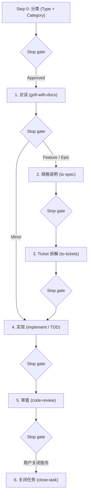

# StrataHarness

[English](README.md) | [Русский](README.ru.md) | [简体中文](README.zh-CN.md) | [Español](README.es.md) | [Français](README.fr.md) | [Português (Portugal)](README.pt-PT.md)

> **注意：** 本文档翻译自 [README.md](README.md)。如存在任何分歧或歧义，请以英文原文为准。

这是一个用于与自主 AI 编程智能体进行软件开发的生产就绪型模板仓库（Template Repository）。它提供了结构化的 6 阶段开发生命周期、显式的停止门控（stop gates）、上下文管理协议，以及一套完备的专用智能体技能库（skills）。

支持的 AI 智能体环境：
- **Google Antigravity**（原生支持规则与技能）
- **Claude Code**（自动镜像技能至 `.claude/skills/`，通过 `CLAUDE.md` 配置规则）
- **OpenAI Codex / Codex CLI**（通过轻量级 `AGENTS.md` 配置规则）
- **Cursor**（通过 `AGENTS.md` 配置规则）

---

## 环境要求

### 使用本模板的项目
- **git**（版本 ≥ 2.30）
- **PowerShell 7+** (`pwsh`) — 用于在 Windows、macOS 和 Linux 上运行自动化脚本、初始化、更新和完整性检查。

### 仅用于模板本身开发
- **Pester 5+** — PowerShell 测试框架 (`Install-Module Pester -MinimumVersion 5.0.0`)。仅供模板维护者运行 `tests/` 下的测试用例。下游项目无需安装。

---

## 创建新项目

1. **从模板创建仓库：**
   - 点击 GitHub 界面上的 **"Use this template"**，或克隆特定发布标签的仓库：
     ```powershell
     git clone --branch v1.0.0 https://github.com/cannoneer85-svg/StrataHarness.git my-project
     cd my-project
     ```
2. **初始化项目：**
   - **通过 AI 智能体（推荐）：** 在智能体会话中输入 `/init-project`（或说 *"Initialize new project"*）。智能体将运行确定性脚本，并引导你配置任务跟踪器、技术栈（[`.agents/CONTEXT.md`](.agents/CONTEXT.md)）和编码规范（`CODING_STANDARDS.md`）。
   - **或直接通过终端：**
     ```powershell
     pwsh -NoProfile -File .agents/skills/init-project/scripts/Initialize-Project.ps1 -Mode New -Tracker local
     ```

### `New` 模式执行内容
- 清理模板开发元数据与发布文件（`tests/`、`docs/dry-run-checklist.md`、模板规格说明与 ADR、`LICENSE`、`CHANGELOG.md`、`VERSION`、`.github/`、`README.ru.md`、`README.zh-CN.md`、`README.es.md`、`README.fr.md`、`README.pt-PT.md`、`CONTRIBUTING.md`、`SECURITY.md`、`docs/releasing.md` 以及 `release` 技能）。
- 保留 [`THIRD_PARTY_NOTICES.md`](THIRD_PARTY_NOTICES.md)。
- 为你的项目建立初始框架骨架（`README.md`、[`.agents/CONTEXT.md`](.agents/CONTEXT.md)、`CODING_STANDARDS.md`、`docs/handoff/LATEST.md`）。
- 在技能注册表表头记录模板版本（`vX.Y.Z (<sha>)`）及来源。
- 配置任务跟踪器（例如 `.scratch/<feature>/issues/` 中的本地跟踪器）。

---

## `Initialize-Project.ps1` 模式

生命周期自动化引擎（[`.agents/skills/init-project/scripts/Initialize-Project.ps1`](.agents/skills/init-project/scripts/Initialize-Project.ps1)）支持 4 种模式，既可以通过 AI 智能体交互式调用，也可以直接在 PowerShell 中执行：

| 模式 | 作用 | AI 智能体调用方式 | CLI 直接执行命令 |
|---|---|---|---|
| **New** | 基于模板创建干净的新项目（清理元文件，安装基础骨架）。 | `/init-project` 或 *"Initialize new project"* | `pwsh -NoProfile -File .agents/skills/init-project/scripts/Initialize-Project.ps1 -Mode New -Tracker local` |
| **Adopt** | 将技能与规则引入现有代码库，不覆盖用户已有文件。输出冲突报告并更新 `.gitignore`。 | `/init-project adopt` 或 *"Adopt StrataHarness into existing project"* | `pwsh -NoProfile -File <template-path>/.agents/skills/init-project/scripts/Initialize-Project.ps1 -Mode Adopt -RepoRoot . -Tracker local` |
| **Update** | 从新版模板更新现有项目中的规则与技能。不带 `-Apply` 仅显示 diff 和 changelog（dry-run）；带 `-Apply` 应用变更。 | `/init-project update` 或 *"Update template skills"* | `pwsh -NoProfile -File <template-path>/.agents/skills/init-project/scripts/Initialize-Project.ps1 -Mode Update -RepoRoot . -Apply` |
| **SetTracker** | 切换任务跟踪器提供商（`local`、`github` 或 `gitlab`）。 | `/init-project tracker` 或 *"Switch tracker to github"* | `pwsh -NoProfile -File .agents/skills/init-project/scripts/Initialize-Project.ps1 -Tracker github` |

所有模式均为幂等设计，可安全重复执行。

### 任务跟踪器提供商

StrataHarness 提供 3 种任务跟踪器适配器，通过 `-Tracker <provider>` 配置：

| 提供商 | Issue 存储位置 | 环境要求 | 适用场景 |
|---|---|---|---|
| **`local`** *(默认)* | 位于 `.scratch/<feature>/issues/` 下的本地 Markdown 文件，附带依赖关系图 `TICKETS.md`。 | 无。完全支持离线工作。 | 个人独立开发、私有代码仓库，或无外部依赖的自闭环 AI 会话。 |
| **`github`** | 仓库内的 GitHub Issues。 | 已安装并登录 GitHub CLI (`gh`) (`gh auth login`)。 | 托管在 GitHub 上的开源或团队协作项目；支持关联 Ticket 与 PR 及 Milestone。 |
| **`gitlab`** | 项目内的 GitLab Issues。 | 已安装并登录 GitLab CLI (`glab`) (`glab auth login`)。 | 托管在 GitLab / GitLab 自建实例上的项目；支持关联 Issue 与 Merge Request。 |

你可以随时通过 `Initialize-Project.ps1 -Tracker <provider>`（或向智能体发出请求 *"Switch tracker to github"*）切换提供商。此操作仅修改 [`docs/agents/issue-tracker.md`](docs/agents/issue-tracker.md) 和 [`AGENTS.md`](AGENTS.md)，不触及任何业务应用代码。

---

## 开发生命周期（工作流概述）

智能体行为受 [`AGENTS.md`](AGENTS.md) 中严格规则的约束（Claude Code 对应镜像文件为 [`CLAUDE.md`](CLAUDE.md)）。



### 1. Step 0 — 工作前分类
在初始响应中，智能体声明 **Type** 和 **Category** 并附带一行理由，等待用户确认：
- **Type：**
  - `Development` — 变更代码、配置或测试。
  - `Analysis` — 产出在 `docs/analysis/` 下的研究文档，代码保持不变。
- **Category（针对 Development）：**
  - `Minor` — 1–2 个文件，单一模块，无新实体或外部集成。
  - `Feature` — 单一子系统，新页面/接口/实体，基于已知 API 的集成。
  - `Epic` — 多个模块，核心架构或横切合约变更，大量未知因素。
  - `Fog (Туман)` — 路径尚不清晰；流转至 `wayfinder` 以消除不确定性。

### 2. 路由与访谈轮次
- **Minor:** 1 轮（Outline & happy path）→ In-Place 原地实现 → 审查 → 关闭。
- **Feature:** 2 轮（Happy path + Errors & edge cases）→ `docs/specs/` 下的规格说明 → `.scratch/<feature>/issues/` 下附带依赖图 `TICKETS.md` 的 Ticket 列表 → 实现 → 审查 → 关闭。
- **Epic:** 3 轮（Happy path + Errors & edge cases + NFR）→ 规格说明 → Ticket 列表 → Orchestrator 编排实现（每个 Ticket 启动独立子智能体）→ 审查 → 关闭。
- **Analysis:** 1 个简短轮次（4 个要点）→ 调研分析 → `docs/analysis/` 下形成草稿 → 审查确认 → 关闭。
- *无问题上限：* 轮次将持续探索未决的决策前沿直至明确；跟进问题在当前主题内自适应分支，不设人为的问题计数上限。

### 3. 停止门控（Stop Gates）
- **单步单回合响应：** 智能体绝不跳过任何阶段，在每个 Stop Gate 处暂停并展示当前成果，等待用户明确批准后方可继续。
- **硬性安全护栏：** 未经用户明确指令（如 «закрывай задачу», «фиксируй», «делай handoff»），智能体绝不提交 git、不清理 `.scratch/`，亦不关闭任务。`/release` 指令是唯一允许推送远程的指令，且**仅**在 release stop gate 得到明确确认后执行；任何情况下均严禁 force-push。其他技能（包括 `/close-task`）绝不执行 `git push`。

### 4. Handoff 与 Close-task
- **Handoff ([`/handoff`](.agents/skills/handoff/SKILL.md)):** 将会话上下文持久化保存到 `docs/handoff/YYYY-MM-DD-<topic>.md`，更新 `docs/handoff/LATEST.md`，并清理已完成的 Ticket。**绝不进行 git commit。**
- **Close-task ([`/close-task`](.agents/skills/close-task/SKILL.md)):** 审查通过并收到用户指令后完全关闭任务。运行预检、生成 handoff、清空 `.scratch/<feature>/`，并生成单个本地提交。**绝不进行 git push。**

### 5. 上下文预算（Smart Zone）
- 工作上下文维持在 **Smart zone**（≈120k tokens）之内。
- 在编写代码之前，智能体根据任务规模选择执行策略：**In-Place**（当前会话内实现）、**Sequential Subagents**（单 Ticket 单子智能体编排）或 **Multi-Session**（跨会话通过 handoff 推进）。

---

## 模板版本管理与升级

本模板遵循[语义化版本控制规范 (SemVer)](https://semver.org/)：
- 版本事实来源为 [`VERSION`](VERSION) 文件（`X.Y.Z`）以及带注释的 git 标签（`vX.Y.Z`）。
- 变更日志记录于 [`CHANGELOG.md`](CHANGELOG.md)。

### 更新下游项目
如需将本模板的改进、错误修复或新技能引入已有项目：

1. **通过 AI 智能体（交互式）：**
   直接告诉智能体 *"Update template skills"*（或输入 `/init-project update`）。智能体会检查你当前记录的 `template-version`，对比上游模板，展示 CHANGELOG diff 与重大变更说明，并在获得确认后执行应用。

2. **直接通过 PowerShell：**
   - 获取或克隆目标模板发布标签：
     ```powershell
     git clone --branch v1.1.0 https://github.com/cannoneer85-svg/StrataHarness.git ../template-release
     ```
   - 预览变更（dry-run 预演）：
     ```powershell
     pwsh -NoProfile -File ../template-release/.agents/skills/init-project/scripts/Initialize-Project.ps1 -Mode Update -RepoRoot .
     ```
     脚本将检查记录的 `template-version`，显示目标版本，打印期间各版本的 CHANGELOG 摘要，并高亮任何 MAJOR 重大破坏性变更。
   - 应用更新：
     ```powershell
     pwsh -NoProfile -File ../template-release/.agents/skills/init-project/scripts/Initialize-Project.ps1 -Mode Update -RepoRoot . -Apply
     ```

---

## 导航与文档索引

- **技能路由导航：** [`/ask`](.agents/skills/ask/SKILL.md) — 交互式技能查找工具。
- **技能注册表：** [`.agents/SKILLS.md`](.agents/SKILLS.md) — 已注册技能及其元数据的完整目录。
- **领域术语词汇表：** [`.agents/CONTEXT.md`](.agents/CONTEXT.md) — 统一的过程与领域概念定义。
- **架构决策记录 (ADR)：** [`docs/adr/`](docs/adr/) — 架构决策日志。
- **发布自动化说明：** [`docs/releasing.md`](docs/releasing.md) — 发布工作流、版本升级规则及 GitHub 配置。
- **贡献指南：** [`CONTRIBUTING.md`](CONTRIBUTING.md) — 贡献指南、Conventional Commits 约定及 PR 检查清单。
- **安全策略：** [`SECURITY.md`](SECURITY.md) — 漏洞报告指引与支持版本。
- **开源许可证：** [`LICENSE`](LICENSE) — MIT 许可证。
- **第三方声明：** [`THIRD_PARTY_NOTICES.md`](THIRD_PARTY_NOTICES.md) — 衍生改编技能的版权归属及授权声明。
- **俄语版本文档：** [`README.ru.md`](README.ru.md) — 本指南的完整俄语翻译版本。
